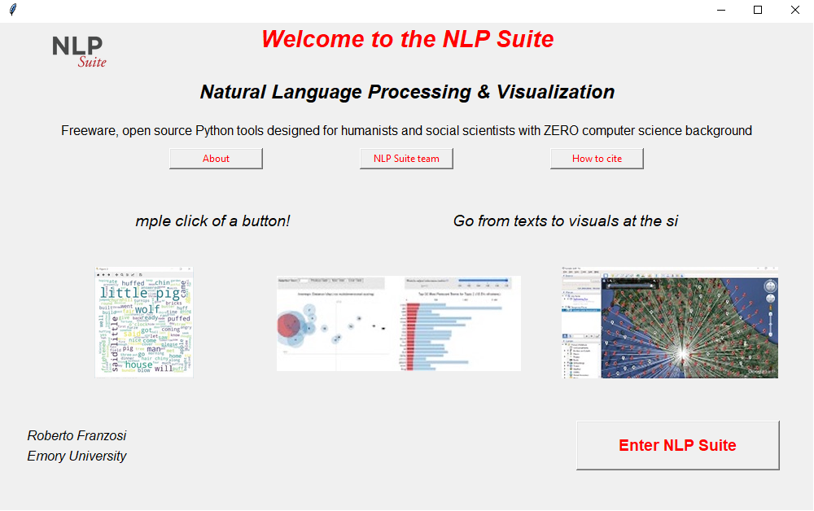
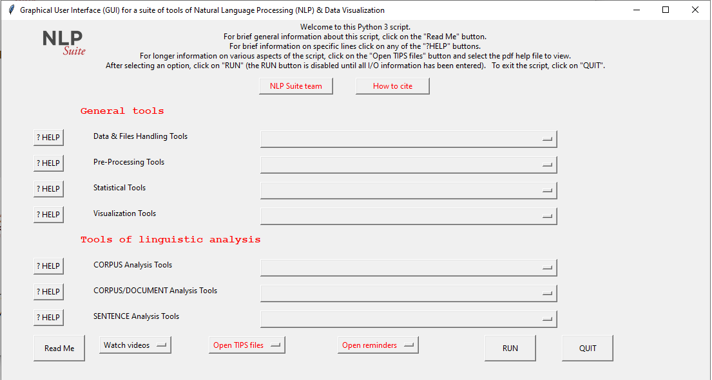

### NLP Suite    

**The NLP Suite is expanding in functions and help files all the time.** The current release consists of:

  1. Over 220 Python 3 files with several hundred functions,
  2. Over 170 TIPS (help) files.

The TIPS complement, with far more extensive explanations, the online HELP, ReadMe, and reminder messages available for each tool.

The Python scripts in the NLP Suite have filenames that clearly identify the Suite architecture.
Filename suffixes designate two different types of files: main and util.

## *_main* files

Each _main file includes the tkinter Graphical User Interface (GUI) that makes complex tasks available to non-specialists at the click of a button. Each GUI comes with a set of ?HELP buttons that provide minimal help for a specific line in the GUI, a ReadMe button for overall help on the tools available for the GUI, a set of pdf TIPS files for detailed help, and reminders for the novice.

## *_util* files

The _util files do all the computational heavy lifting behind each _main script.

## *Filename* prefixes

Filename prefixes cluster together scripts used for the same purpose. Thus, `html_annotator` identifies all files dealing with html annotation, via DBpedia, YAGO, or dictionary files; `GIS` all files dealing with geographic maps.

## Running a single GUI from source

If you run the NLP Suite from source code (see the [Developer Setup](https://github.com/NLP-Suite/NLP-Suite/wiki/Installation-of-the-NLP-Suite#developer-setup-run-from-source)), every script suffixed by `main` can be run independently of `NLP_menu_main.py`. For instance, `python src/wordclouds_main.py` opens the word clouds GUI without the menu. In the standalone build, open every GUI from the NLP Suite menu.

## The look of the NLP Suite

## Welcome to the NLP Suite Window

The first few times you start the NLP Suite you will see the following window with the rolling banner "Go from texts to visuals at the simple click of a button!" and rotating images of what the NLP Suite produces in output.

## NLP Suite Menu Window

Upon entering the Suite, the menu window visualizes the range of options available to the user and for different tasks. The linguistic analysis tools are divided into

1. Tools that can only work for large corpora (e.g., topic modeling, Word2Vec, Ngram and Co-Occurrence Viewer, data reduction algorithms to compute and visualize the "shape of stories")

2. Tools that can deal indifferently with large sets of text files or a single file (e.g., the parsers and annotators, knowledge-base annotators such as DBpedia or YAGO, WordNet, word clouds, sentence complexity and text readability, nominalization, Subject-Verb-Object extractor).

3. Tools that work at the sentence level.

The NLP Suite relies on three freeware parsers and annotators: [Stanza](https://stanfordnlp.github.io/stanza/) (the default), [Stanford CoreNLP](https://stanfordnlp.github.io/CoreNLP/) and [spaCy](https://spacy.io/). They provide the basic parser and a variety of annotators (Named Entity Recognition, normalized dates, sentiment analysis, coreference; gender and quote with CoreNLP).

More generally, the Suite relies on a wide variety of Python 3 packages stitched together to provide a hassle-free experience for non-experts.

Several GUIs provide seamless pipelines, going from text to geographic maps, from text to SVOs mapped in network graphs and maps, from text to narrative elements and their visualization.

 
